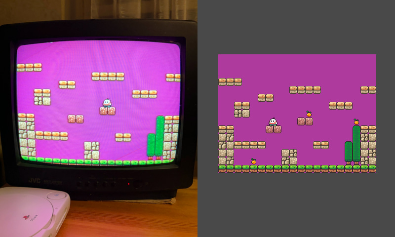
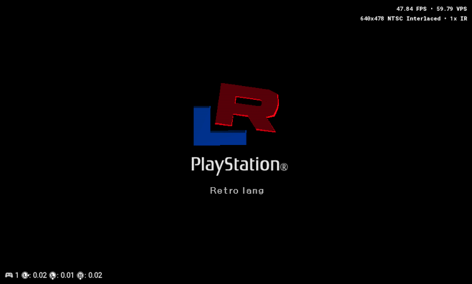

The goal of this project is to build a PlayStation 1 development toolchain completely from scratch, without relying on GCC, LLVM, or other similar compiler frameworks. It features a low-level C-like language, Retrolang, that compiles to MIPS R3000 machine code.

Retrolang tools are written entirely in [D language](https://dlang.org/).

What you can do with Retrolang:

- Render 2D and 3D graphics via command buffers and the DMA
- Upload TIM files to VRAM
- Work with the GTE
- Query the gamepad buttons and analog sticks
- Load files from the CD-ROM
- Access memory cards
- Play VAG sounds
- Play SEQ music files
- Play CDDA tracks
- Play XA audio streams
- Play STR video streams
- Work with the BIOS
- Set custom interrupt handlers.

All provided software is in alpha stage.

## Screenshots

Platformer game example:



3D rendering example:


Custom boot logo:



## Rationale

Retrolang is a result of 10+ years of tinkering with the console, different SDKs, custom GPU libraries and related tools. It was initially created as an assembler, but eventually got many improvements. I've always wanted to write programs for PSX, but the tooling was frustratingly clunky, so I eventually decided to make my own everything, right down to the machine code.

Main philosophy of the project: PSX programming doesn't require a full-fledged C with all of its baggage. A subset is sufficient. What's really needed are platform-specific language capabilities, as well as a simple, readable and easily hackable standard library. Popular C toolchains also tend to be bulky; Retrolang produces tiny executables that can run via [FreePSXBoot](https://github.com/brad-lin/FreePSXBoot).

Project goals:
- Provide a convenient domain-specific language as a trade-off between C and assembly for hobby R3000 programming, with straightforward, unhindered hardware access;
- Provide a modern, open, self-contained toolset with x86_64 replacements for legacy utilities;
- Provide a clean-room SDK that doesn't depend on a single byte of proprietary software.

Retrolang reimplements software in cases when existing solutions are outdated, unmaintained or not convenient enough. Otherwise, the SDK doesn't reinvent the wheel and relies on time-proven tools (one example is [mkpsxiso](https://github.com/lameguy64/mkpsxiso)).

## Tools

### RLC

The main tool is RLC, the Retrolang Compiler. It combines an assembler, compiler, and a linker in a single program and directly outputs `PSX.EXE`.

Usage:

```
rlc -o PSX.EXE src/main.r
```

Assembling command is similar (RLC treats *.s file as an assembly source):

```
rlc -o PSX.EXE src/main.s
```

### Retrobuild

Build automation system. With Retrobuild, you don't have to call the compiler directly or write platform-specific scripts. It compiles a project, packs it into a CD-ROM image (CUE+BIN) using mkpsxiso, and generates a CU2 sector index for [PSIO](https://psio.cybdyn-systems.com.au/). Uses TOML manifest files (`retrobuild.toml`) to describe projects.

### PSXDISASM

Disassembler and dumper for MIPS R3000 binaries.

### PNG2TIM

A simple PNG to TIM converter.

### WAV2VAG

PCM WAV files to ADPCM VAG converter.

### XA Tool

XA stream encoder/interleaver. Supports PCM WAV, XA-ADPCM, MP3, OGG/Vorbis, FLAC, QOI, OPUS, MOD, XM files as input.

### DATWrite

An utility that generates CD license patch (a *.dat file) with a custom text and logo model.

### GPSXEmu

Work-in-progress PlayStation emulator.

## The Language

Retrolang can be called "ANSI C from an alternate universe". It is a simple curly-bracket procedural language largely inspired by C, but based on different architectural decisions and designed to run in extremely memory-constrained environments. Unlike C, Retrolang is a language with **predictable semantics**. The compiler translates your program verbatim, without optimizations and unexpected changes behind your back, which is important for bare-metal programming. For example, it doesn't implicitly inline functions and optimize memory access. You are solely responsible for writing good-quality code and using the console's limited resources wisely.

**Primitive types**: `int`, `short`, `char`, `uint`, `ushort`, `uchar`, `void`, and pointers to them. Pointers compare as unsigned. Literals above `0x7FFFFFFF`, or with a 'u' suffix, are unsigned. Like C, `uchar`/`ushort` promote to (signed) `int` in arithmetic; only `uint` makes `/`, `%`, `>>` and comparisons unsigned. C-style type casts are supported.

**Arrays**: C-like static arrays and strings:

```c
int t[4] = {1, 2, 3, 4};
char hello[] = "Hello!";
```

Constant initialization is supported only for global arrays.

**Structs**: top-level definitions `struct Name { int a; uchar c[3]; };`. Used as `struct Name x;`. Fields may be scalars, pointers, arrays or nested structs. Structs can be copied with `=` (inline, up to 32 words), have their address taken, and be measured with `sizeof(struct Name)`. Not supported: struct initializers, passing/returning structs by value, unions, bit-fields, `typedef`, `sizeof(expression)`.

**Operators**: all basic arithmetic, logical and bitwise operators are supported. Retrolang uses C precedence.

**Statements**: `if`/`else`, `while`, `do`-`while`, `for`, `break`, `continue`, `return`.

**Function calls**: follows O32 ABI. Supports up to 4 arguments (passed in `$a0`-`$a3`), result in `$v0`.

**Program entry point**: `main()`, started from a small stub that sets `$sp`.

**Modules**: RLC implements a [unity build](https://en.wikipedia.org/wiki/Unity_build) compilation method which is a trade-off between C-style `#include` and a full-featured module system. There are no symbol tables or module-local scopes; the program is a single bundle with one global scope. RLC builds all source modules together in one pass; it does not produce object files or support incremental builds. The `#import "file.r"` directive adds a module into the bundle, ensuring each module is parsed only once. See [documentation](/doc/Basics.md#1-toolchain) for details.

**BIOS intrinsics**: `bios_a(n, ...)`, `bios_b(n, ...)`, `bios_c(n, ...)` through the `A0h`/`B0h`/`C0h` vectors with up to 4 further arguments. `n` is a constant function number which is passed in `$t1` register.

**Coprocessor intrinsics**: `gte_enable`, `ctc2`, `mtc2`, `gte_rtpt` and others.

**Embedded files**: a global array can have an attribute `@("file.bin")` to embed a file to the executable.

**Inline assembly**: functions can contain `asm` blocks with Retrolang assembly language code.

**AST macros**: abstract reusable expressions and statements. Retrolang supports expresson macros, parametrized expresson macros, list macros (tuples), and statement macros. They are useful for defining constants, inlining performance-critical functions and GTE command blocks.

**Static allocator**: a static array can be placed in an arbitrary region of available RAM using the region attribute: `@(0x80180000, 1024)`. Regions work like static arenas: the compiler automatically bumps offset for a new allocation that shares the region base address with existing allocation. List macros can be used to identify regions. Base addresses must be given in KSEG0.

**Example program:**

```c
#import "retrolib.r"

void main()
{
    printf("Hello, World!\n");
}
```

The same in Retrolang assembly language:

```asm
.text
  start:
    li $a0, msg
    li $t1, 0x003f
    li $t2, 0x00a0
    jalr $t2
    nop
    
  loop:
    li $t0, loop
    jalr $t0
    nop

.data
    msg: .asciiz "Hello, World!\n"
```

See [doc folder](/doc) for more details on the language.

## Retrolib

Retrolib is a system library that simplifies working with the PlayStation hardware. In includes device drivers, BIOS API, and, additionally, full support for [PCSX-Redux binary API](https://pcsx-redux.consoledev.net/mips_api/) that allows programs to communicate with the emulator for debugging purposes.

Core modules:

* `retrolib.r` - imports entire library at once
* `retrolib_mini.r` - imports a minimal part of the library to reduce executable size
* `core.r` - core definitions
* `bios.r` - macros for some common BIOS calls
* `irq.r` - interrupts API
* `dma.r` - DMA API
* `pad.r` - gamepad driver
* `gpu.r` - GPU driver / graphics API
* `spu.r` - SPU driver / sound API
* `cd.r` - CD audio API
* `xa.r` - XA audio API
* `save.r` - memory card save/load API
* `mdec.r` - MDEC driver
* `vlc.r` - VLC decoder
* `str.r` - STR video API
* `iso.r` - ISO 9660 file lookup
* `vab.r` - VAB sound bank loader
* `seq.r` - SEQ music sequencer.

Additional modules (not included to `retrolib.r`):

* `pcsx.r` - PCSX-Redux API.

Usage (assuming you've pointed RLC to `retrolib` as an include/import directory):

```c
#import "retrolib.r"
```

## Examples Collection

`examples` directory contains a number of basic demos showcasing possibilities of Retrolang and Retrolib.

- [asm](/examples/asm) - "Hello, World" program implemented in assembly language
- [inline_asm](/examples/inline_asm) - assembly function example (printing an argument to TTY and returning a value)
- [pad](/examples/pad) - gamepad test, logs pressed buttons to TTY
- [triangle](/examples/triangle) - classic colored triangle demo (direct rendering via GP0)
- [dma](/examples/dma) - classic colored triangle demo (queued rendering via a command buffer)
- [sprite](/examples/sprite) - TIM texture loading and sprite rendering (direct rendering via GP0)
- [text](/examples/text) - bitmap font loading and text rendering (queued rendering via a command buffer)
- [platform_game](/examples/platform_game) - 2D platform game demo with a level editor
- [mesh](/examples/mesh) - walkable 3D scene with a first person camera
- [memcard](/examples/memcard) - memory card reading and writing
- [vag](/examples/vag) - VAG sound playback example
- [cd_audio](/examples/cd_audio) - CD audio playback example
- [xa](/examples/xa) - XA audio playback example
- [video](/examples/video) - STR video playback example
- [seq](/examples/seq) - SEQ music playback example.

All examples support building with Retrobuild. RLC must be available system-wide or locally as `/rlc/rlc.exe` in the repository. Optionally, to build a CD-ROM image, mkpsxiso must be available system-wide or locally as `/mkpsxiso/mkpsxiso.exe` in the repository. Some examples depend on PNG2TIM, WAV2VAG, XA Tool and other utilities to convert assets.

## Recommended Tools

Provided examples rely on the following third-party tools:

- [mkpsxiso by Lameguy64](https://github.com/lameguy64/mkpsxiso) to build CD-ROM images
- [psxavenc](https://github.com/WonderfulToolchain/psxavenc) to encode STR videos
- [Blender](https://blender.org) to export meshes to PlayStation-oriented formats.

For running examples on the PC, we recommend [DuckStation](https://www.duckstation.org/), a fast and feature-rich PlayStation emulator for Windows, Linux and Mac. To run an image (or directly `PSX.EXE` if you don't build an image), use the following command:

```
duckstation -fastboot -- %~dp0/game.bin
```

or

```
duckstation -fastboot -- %~dp0/iso/PSX.EXE
```

## Testing

Retrolang is tested on a real hardware and in the following emulators:

- DuckStation
- PCSX-ReARMed
- PCSX-Redux
- XEBRA
- no$psx
- ePSXe

## TODO

What is not implemented yet:

- Matrix math
- TMD models support

## License

RLC, PSXDISASM, Retrobuild, PNG2TIM, WAV2VAG, XA Tool, DATWrite, GPSXEmu are distributed under the Boost Software License, 1.0.

Retrolib and all examples are distributed under Unlicense/Public Domain.

## Special Thanks To

- [Martin Korth aka nocash](https://problemkaputt.de/) for his excellent [PlayStation spec](https://problemkaputt.de/psxspx-contents.htm)
- Joshua Walker for his book [Everything You Have Always Wanted to Know about the Playstation But Were Afraid to Ask](https://www.romhacking.net/documents/127/)
- [Lionel Flandrin aka simias](https://github.com/simias) for his [PlayStation emulation guide](https://github.com/simias/psx-guide)
- [IDT R30xx Family Software Reference Manual](https://cgi.cse.unsw.edu.au/~cs3231/doc/R3000.pdf) by Integrated Device Technology, Inc.
